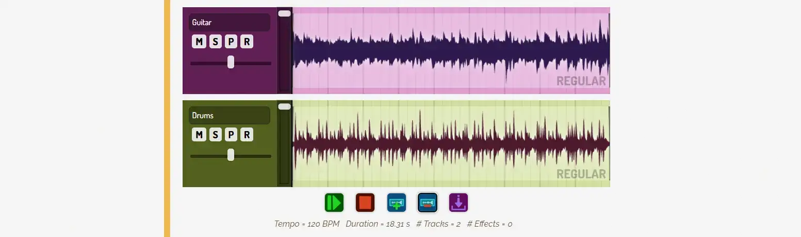

# PQ DAW

**Pandaqi DAW** is a small, limited web implementation of a "Digital Audio Workstation". 

It uses vanilla website code (HTML, CSS, JavaScript), no dependencies, so it stays small and can be embedded into any web page.

## Why?

I created it to add interactive examples to my free [Music Mixing](https://pandaqi.com/tutorials/audio/music-mixing/) guide. 

In the future, it might be used in more guides on [Pandaqi Tutorials](https://pandaqi.com/tutorials). Because, well, I went a bit overboard and turned it into much more than just small example.

It was designed to plug into the Hugo static website generator that powers Pandaqi, but it works just as well in any other HTML page.

## How to use it?

Three steps.

* Download all files in the `dist` folder.
* Place the `static` assets on your own (local) server (icons, extra sound files for the reverb plugin, ...)
* Load the CSS and JS files on your page.
* Any element with the class `pq-daw-wrapper` is automatically turned into a small DAW widget.

The Hugo stuff is **optional**. It just provides a faster way to initialize a DAW with specific settings by utilizing the _shortcodes_. You can create the DAW completely from script, or recreate these few simple HTML nodes in your own system.

If you place the static assets somewhere else, you'll need to update the URL path to it in the CSS.

Alternatively: include the TypeScript assets from `src` directly into your project and import the parts you need right into your code.

## What can it do?

It mimics the basic functionality any music software will have. For free! Right in your browser! 

Create tracks. Record audio. Apply effects. Trim the audio, match to the beat, fade in/out, upload audio from your own computer, and get mixing/mastering.

It does so using the "Web Audio API", which is built into every browser by default. It was also designed to be able to _hide_ any part (to simplify the examples in my tutorials) and be as simple as possible. It surely misses a lot of functionality---feel free to use this as a starting point.

Check the [Documentation](DOCS.md) for all the details.